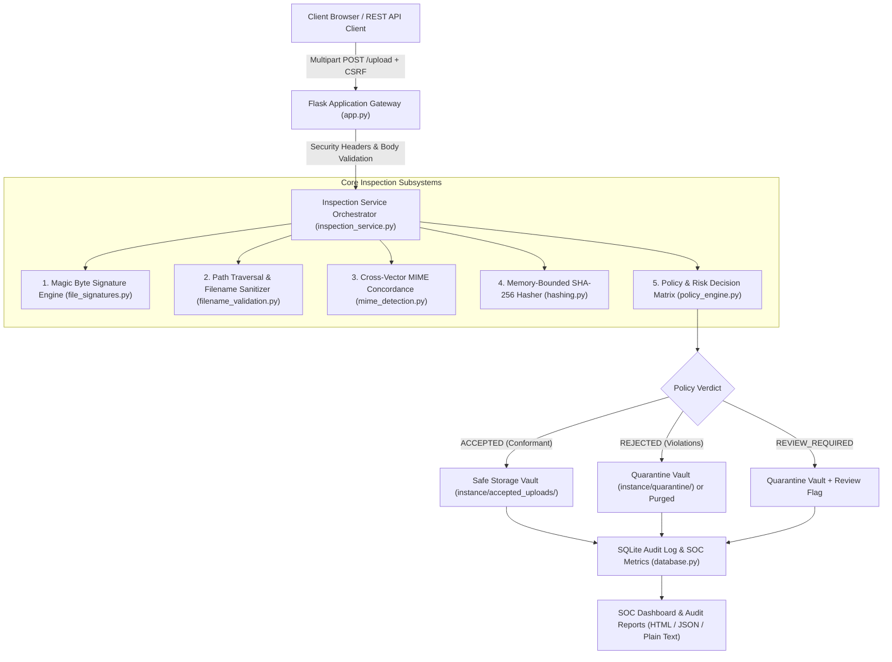
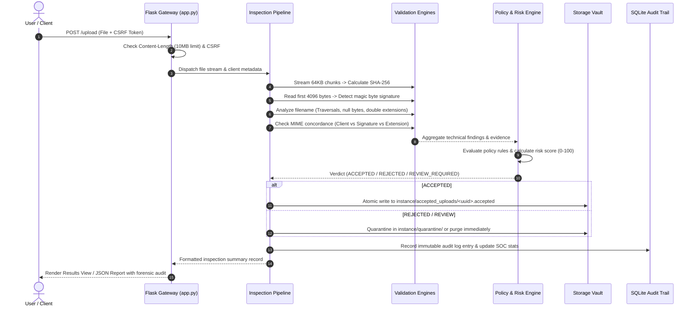
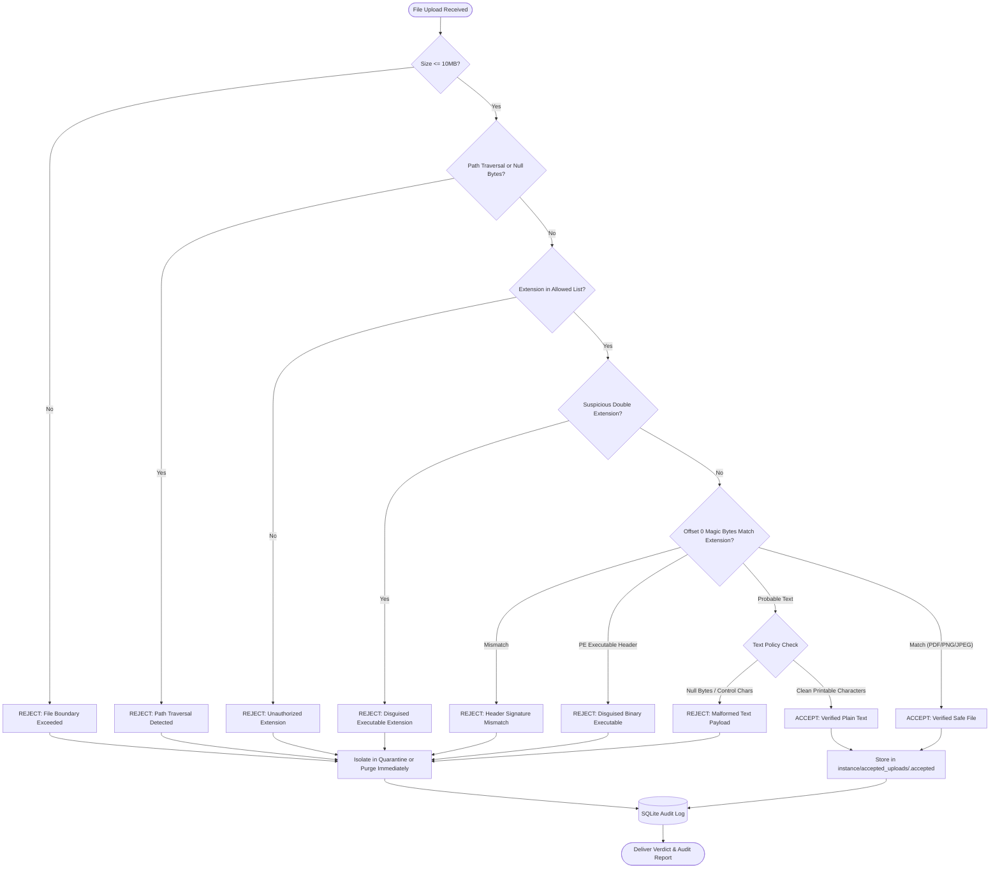

# EHMICRO — SecureUpload Inspector

> **A Multi-Vector Cybersecurity Verification Engine & Defense-in-Depth File Ingestion System**  
> *Academic Micro-Project demonstrating advanced file validation, magic-byte inspection, memory-bounded hashing, and storage isolation.*

[](https://www.python.org/downloads/)
[](https://opensource.org/licenses/MIT)
[](https://docs.pytest.org/)
[](https://owasp.org/)
[](https://cwe.mitre.org/data/definitions/434.html)

---

## 📑 Table of Contents

1. [Executive Summary & Why This Matters](#1-executive-summary--why-this-matters)
2. [Naive Upload vs. SecureUpload Inspector](#2-naive-upload-vs-secureupload-inspector)
3. [System Architecture](#3-system-architecture)
4. [Security Design & Threat Model](#4-security-design--threat-model)
   - [The 5 Inspection Vectors](#the-5-inspection-vectors)
   - [Storage Isolation & Quarantine Vaults](#storage-isolation--quarantine-vaults)
   - [Heuristic Risk Scoring](#heuristic-risk-scoring)
5. [End-to-End Workflow](#5-end-to-end-workflow)
   - [Lifecycle Sequence Diagram](#lifecycle-sequence-diagram)
   - [Inspection Decision Logic](#inspection-decision-logic)
6. [Repository Structure](#6-repository-structure)
7. [Quick Start & Installation](#7-quick-start--installation)
8. [Automated Test Suite (86 Tests)](#8-automated-test-suite-86-tests)
9. [Demonstration Scenarios (Test Cases A–J)](#9-demonstration-scenarios-test-cases-aj)
10. [Academic Security Assertion & Disclaimer](#10-academic-security-assertion--disclaimer)

---

## 1. Executive Summary & Why This Matters

Unrestricted and naive file uploads remain one of the most dangerous vulnerabilities in modern web applications (**OWASP Top 10 A04/A08** and **CWE-434**). Insecure upload handling routinely leads to:
- **Remote Code Execution (RCE):** Attackers upload server-side scripts (e.g., PHP webshells, Python scripts, or PE binaries) and trigger their execution.
- **Directory Traversal:** Malicious filenames containing `../` escape sequences write files over critical system directories (e.g., overwriting `.ssh/authorized_keys` or system binaries).
- **Denial of Service (DoS):** Processing massive files or zip-bombs without bounds exhausts server RAM, thread pools, and disk capacity.
- **Client-Side Attacks & Polyglots:** Files that masquerade as images or PDFs while carrying active payloads or cross-site scripting (XSS) vectors.

**SecureUpload Inspector** replaces naive, surface-level validation with a **deterministic, defense-in-depth security verification engine**. Operating completely offline without external cloud dependencies, it evaluates files across five independent inspection vectors, enforces strict storage segregation, logs immutable forensic audit trails to SQLite, and provides an interactive Security Operations Center (SOC) dashboard.

---

## 2. Naive Upload vs. SecureUpload Inspector

| Inspection Layer | Naive Web Application | SecureUpload Inspector |
| :--- | :--- | :--- |
| **Extension Check** | Checks `filename.endswith(".pdf")` (easily spoofed as `malware.exe.pdf`) | Multi-tier allowlist, obfuscated double-extension interception (`file.pdf.exe`), and strict normalization |
| **MIME Validation** | Reads HTTP `Content-Type` header (trivially forged via curl or Burp Suite) | Cross-vector concordance: checks client header against extension and true magic-byte signature |
| **Content Inspection** | None (assumes file matches its declared extension) | Low-level magic-byte inspection at offset 0 (PDF, PNG, JPEG, PE/MZ) + text heuristics |
| **RAM Protection** | Reads entire file into memory (`file.read()`), causing RAM exhaustion | Memory-bounded 64 KB chunked streaming for SHA-256 fingerprinting |
| **Storage Strategy** | Saves file with user's original name directly in public web root (`static/uploads/`) | Isolated vaults outside web root, cryptographically random UUIDs (`<uuid>.accepted`), non-executable permissions (`0o600`) |
| **Rejected Files** | Leaves temporary files on disk or exposes detailed tracebacks | Atomic write-then-rename prevents partial writes; rejected files are strictly quarantined or purged immediately |
| **Audit & Governance** | Minimal or absent logging | Immutable SQLite audit logs, dynamic SOC dashboard, plain-text audit reports, and JSON forensics |

---

## 3. System Architecture

The application is structured into clearly separated, decoupled tiers following clean architecture principles:



### Architectural Tiers

1. **Gateway & Presentation Layer (`app.py`, `templates/`, `static/`):**
   - Implements the Flask application factory pattern.
   - Enforces strict security response headers: `Content-Security-Policy`, `X-Content-Type-Options: nosniff`, `X-Frame-Options: DENY`, `Referrer-Policy: strict-origin-when-cross-origin`.
   - Protects state-changing endpoints with Flask-WTF CSRF tokens.
   - Custom sanitized error handlers (`400`, `404`, `413`, `500`) prevent information disclosure.
2. **Orchestration Layer (`services/inspection_service.py`):**
   - Coordinates the 10-stage inspection pipeline without holding unbounded state in memory.
   - Dispatches file streams to specialized security engines.
3. **Core Inspection Subsystems (`inspector/`):**
   - Five independent, pure-logic inspection engines that evaluate distinct threat vectors.
4. **Isolated Vault & Storage Layer (`services/quarantine_service.py`):**
   - Manages physical file placement on disk outside the application's document root.
   - Employs atomic write-then-rename semantics to eliminate partial file writes.
5. **Persistence & Auditing Layer (`storage/database.py`, `storage/audit_log.py`):**
   - Thread-safe, parameterized SQLite engine recording complete forensic audit trails.

---

## 4. Security Design & Threat Model

### The 5 Inspection Vectors

```
                      [ Untrusted Upload Stream ]
                                   │
      ┌────────────────────────────┼────────────────────────────┐
      ▼                            ▼                            ▼
[ Vector 1: Signatures ]  [ Vector 2: Filename ]       [ Vector 3: Concordance ]
- Offset 0 magic bytes    - Path traversal (..)        - Client MIME vs. bytes
- %PDF-, PNG, JPEG, MZ    - Null bytes (\0)            - Extension vs. signature
- Text character checks   - Double-extensions          - Spoofing detection
      │                            │                            │
      └────────────────────────────┼────────────────────────────┘
                                   │
      ┌────────────────────────────┴────────────────────────────┐
      ▼                                                         ▼
[ Vector 4: Cryptography ]                             [ Vector 5: Policy Matrix ]
- 64 KB streaming SHA-256                              - Deterministic rule engine
- Constant-time comparison                             - Heuristic risk scoring (0-100)
- Memory-bounded buffer                                - Verdict: ACCEPT / REJECT / REVIEW
```

#### Vector 1: Magic Byte Signature Analysis (`inspector/file_signatures.py`)
Rather than trusting the extension, the engine inspects the first 4,096 bytes:
- **PDF:** Must begin with magic bytes `%PDF-` (`0x25 0x50 0x44 0x46 0x2D`).
- **PNG:** Must match the 8-byte signature `\x89PNG\r\n\x1a\n` (`0x89 0x50 0x4E 0x47 0x0D 0x0A 0x1A 0x0A`).
- **JPEG:** Must begin with Start of Image (SOI) marker `\xFF\xD8\xFF`.
- **PE Binaries:** Detects Windows PE executable headers `MZ` (`0x4D 0x5A`) disguised under harmless extensions.
- **Probable Text:** Analyzes UTF-8 decodability, printable ASCII/whitespace frequency (>= 90%), and absence of null bytes. Classified cautiously as *probable text* rather than certified binary.

#### Vector 2: Filename & Path Traversal Sanitization (`inspector/filename_validation.py`)
Intercepts file-system escape attempts:
- Rejects relative directory traversal patterns (`..`, `../`, `..\`).
- Rejects absolute paths (`/etc/passwd`, `C:\Windows\System32`).
- Rejects null-byte injection (`\x00`), which in C-based systems truncates strings to bypass extension checks.
- Intercepts executable double extensions (e.g., `document.pdf.exe`, `invoice.png.scr`, `photo.jpg.php`).

#### Vector 3: Cross-Vector MIME Concordance (`inspector/mime_detection.py`)
Validates that three independent data points agree:
1. Client-declared HTTP `Content-Type` header (e.g., `application/pdf`).
2. Filename extension (e.g., `.pdf`).
3. Low-level magic byte signature (e.g., `%PDF-`).  
*Any contradiction (e.g., a PNG image named `file.pdf` declaring `application/pdf`) triggers immediate policy violation.*

#### Vector 4: Memory-Bounded Cryptographic Hashing (`inspector/hashing.py`)
- Calculates SHA-256 digests incrementally in **64 KB chunks**, preventing large files from exhausting server RAM.
- Employs timing-attack-resistant constant-time comparisons (`hmac.compare_digest`).

#### Vector 5: Policy Engine & Risk Scoring (`inspector/policy_engine.py`, `risk_assessment.py`)
- Evaluates individual modular rules:
  - `POL-SIZE-001` (Zero-byte rejection)
  - `POL-SIZE-002` (Max boundary enforcement)
  - `POL-NAME-001` (Path traversal & dangerous characters)
  - `POL-NAME-002` (Double-extension interception)
  - `POL-EXT-001` (Allowed extension allowlist)
  - `POL-SIG-001` (Signature mismatch rejection)
  - `POL-AGREE-001` (Cross-vector concordance failure)
- Synthesizes findings into one of three definitive verdicts:
  - **`ACCEPTED`:** Conforms strictly to all policies and signature requirements.
  - **`REJECTED`:** Violates security boundaries (path traversal, malicious double extensions, disguised binaries).
  - **`REVIEW_REQUIRED`:** Contains ambiguous heuristic anomalies (e.g., text with unusual control codes).

### Storage Isolation & Quarantine Vaults

```
[ Root Directory ]
├── SecureUploadInspector/
│   ├── static/               <-- PUBLIC WEB ROOT (Never stores user files)
│   └── instance/             <-- RESTRICTED DIRECTORY (Private file system)
│       ├── accepted_uploads/ <-- Accepted vault (UUID filenames, 0o600 permissions)
│       ├── quarantine/       <-- Isolated quarantine vault
│       └── secureupload.db   <-- SQLite audit database
```

1. **Storage Outside Web Root:** Files are stored strictly in `instance/`, completely isolated from `static/`. Web clients cannot execute or request files via direct URLs.
2. **UUID Randomization:** User-supplied filenames are stripped. Files are saved as `<uuid4>.accepted` or `<uuid4>.quarantine`. Original filenames are stored only as metadata in the SQLite audit log.
3. **Atomic Operations:** Files are written to temporary staging files (`.tmp`) and atomically renamed only upon validation completion, preventing corrupted partial files.
4. **Execution Disablement:** Files are saved with strict non-executable permissions (`0o600` on POSIX systems).
5. **Rejection Guarantee:** Rejected files **never** enter the accepted storage vault under any circumstance.

### Heuristic Risk Scoring

The risk score (0–100) aggregates rule violation weights:
- **`CRITICAL` (45 pts):** Path traversal, disguised executable binaries, null bytes.
- **`HIGH` (30 pts):** Signature/extension mismatch, unauthorized executable extensions.
- **`MEDIUM` (15 pts):** Browser MIME header mismatch, ambiguous text heuristics.
- **`LOW` (5 pts):** Non-standard casing, unusual characters.
- **`INFO` (0 pts):** Verified benign properties.

Scores are deduplicated and capped at 100. *Risk scores reflect policy anomalies; they are not a probability of malware.*

---

## 5. End-to-End Workflow

### Lifecycle Sequence Diagram



### Inspection Decision Logic



---

## 6. Repository Structure

```
EHMICRO/
├── .gitignore                          # Global version control exclusions
├── pytest.ini                          # Root test runner configuration
├── README.md                           # Master architectural & technical documentation
└── SecureUploadInspector/              # Core Application Package
    ├── app.py                          # Flask application factory, routes & security headers
    ├── config.py                       # Configuration profiles & policy constants
    ├── requirements.txt                # Pinned production & testing dependencies
    ├── pytest.ini                      # Sub-package pytest configuration
    ├── .env.example                    # Template environment variables
    ├── data/                           # Data persistence directory (.gitkeep)
    ├── instance/                       # Runtime isolated vaults & SQLite database (.gitkeep)
    ├── inspector/                      # Core Security Inspection Engines
    │   ├── __init__.py
    │   ├── file_signatures.py          # Magic-byte detection (PDF, PNG, JPEG, PE/MZ)
    │   ├── filename_validation.py      # Traversal, null byte & extension analysis
    │   ├── hashing.py                  # Streaming cryptographic SHA-256 calculator
    │   ├── mime_detection.py           # Cross-vector MIME concordance checks
    │   ├── policy_engine.py            # Decision matrix & rule evaluation
    │   └── risk_assessment.py          # Bounded heuristic risk scoring (0-100)
    ├── services/                       # Orchestration Services
    │   ├── __init__.py
    │   ├── inspection_service.py       # 10-stage inspection coordinator
    │   ├── quarantine_service.py       # Isolated vaults & atomic safe storage handlers
    │   └── report_service.py           # Plain-text, JSON & printable report generators
    ├── storage/                        # Persistence & Auditing
    │   ├── __init__.py
    │   ├── database.py                 # Thread-safe parameterized SQLite engine
    │   └── audit_log.py                # Structured audit event logger
    ├── static/                         # Frontend Static Assets
    │   ├── css/style.css               # Clean light-theme enterprise stylesheet
    │   └── js/app.js                   # Client-side UI utilities & drag-and-drop
    ├── templates/                      # Jinja2 Security Templates
    │   ├── base.html                   # Master template with CSP meta headers & sidebar
    │   ├── dashboard.html              # SOC live metrics dashboard
    │   ├── upload.html                 # Secure multi-file upload portal
    │   ├── results.html                # Inspection verdict & violation breakdowns
    │   ├── history.html                # Paginated audit log explorer with search filters
    │   ├── inspection_detail.html      # Forensic audit inspection drill-down
    │   ├── settings.html               # Administrative policy control panel
    │   ├── about.html                  # Educational security architecture guide
    │   └── error.html                  # Safe generic error views (400, 404, 413, 500)
    └── tests/                          # Automated Pytest Suite (86 tests)
        ├── conftest.py                 # Pytest fixtures & in-memory test DB
        ├── test_signatures.py          # Magic-byte detection tests
        ├── test_filename_validation.py # Path traversal & double-extension tests
        ├── test_policy_engine.py       # Policy evaluation & risk score tests
        ├── test_hashing.py             # SHA-256 sensitivity & chunking tests
        ├── test_storage_security.py    # Quarantine isolation & permissions tests
        ├── test_upload_routes.py       # HTTP route & CSRF validation tests
        ├── test_reports.py             # Plain-text & JSON report tests
        ├── test_history.py             # Pagination & query filter tests
        ├── test_demonstration_scenarios.py # Scenarios TEST A - TEST J
        └── e2e_verify.py               # Live daemon end-to-end verification script
```

---

## 7. Quick Start & Installation

### Prerequisites
- Python 3.11 or higher
- PowerShell, Bash, or Command Prompt
- `pip` or `uv` package manager

### Option A: Quick Launch with `uv` (Fastest)

```powershell
# 1. Create and populate virtual environment
uv venv .venv --python 3.11
uv pip install -r SecureUploadInspector/requirements.txt --python .venv\Scripts\python.exe

# 2. Run the automated test suite
.venv\Scripts\pytest

# 3. Launch the application
.venv\Scripts\python.exe SecureUploadInspector/app.py
```

### Option B: Standard Python Setup

```powershell
# 1. Create virtual environment
python -m venv .venv
.\.venv\Scripts\Activate.ps1

# 2. Install dependencies
pip install -r SecureUploadInspector/requirements.txt

# 3. Launch application
python SecureUploadInspector/app.py
```

### Localhost Access

When started, the application binds locally:
```
 * Serving Flask app 'app'
 * Running on http://127.0.0.1:5050
```

| Section | Localhost Link | Direct IP Link |
| :--- | :--- | :--- |
| **SOC Dashboard (Home)** | [http://localhost:5050/](http://localhost:5050/) | [http://127.0.0.1:5050/](http://127.0.0.1:5050/) |
| **File Upload & Inspector** | [http://localhost:5050/upload](http://localhost:5050/upload) | [http://127.0.0.1:5050/upload](http://127.0.0.1:5050/upload) |
| **Audit History & Logs** | [http://localhost:5050/history](http://localhost:5050/history) | [http://127.0.0.1:5050/history](http://127.0.0.1:5050/history) |
| **Security Policies & Settings** | [http://localhost:5050/settings](http://localhost:5050/settings) | [http://127.0.0.1:5050/settings](http://127.0.0.1:5050/settings) |
| **Architecture & Threat Model** | [http://localhost:5050/about](http://localhost:5050/about) | [http://127.0.0.1:5050/about](http://127.0.0.1:5050/about) |

---

## 8. Automated Test Suite (86 Tests)

Run the full automated pytest suite from the repository root:

```powershell
.venv\Scripts\pytest -v
```

### Test Coverage Summary:
- **`test_signatures.py` (9 tests):** Header inspection for PDF, PNG, JPEG, text heuristics, null byte detection, and PE binary identification.
- **`test_filename_validation.py` (14 tests):** Traversal attacks (`..`, `/`, `\`), null-byte injections, length bounds, compound extensions, and double extensions.
- **`test_hashing.py` (6 tests):** Incremental 64 KB chunking, sensitivity verification, and constant-time digest comparison.
- **`test_policy_engine.py` (10 tests):** Rule synthesis, risk scoring, deduplication, and capping.
- **`test_storage_security.py` (6 tests):** Safe vault segregation, rejection isolation, UUID assignment, and atomic writes.
- **`test_upload_routes.py` (19 tests):** HTTP route handling, CSRF defense, 413 file size bounds, and HTML sanitization.
- **`test_reports.py` (3 tests):** Plain-text reports, JSON exports, and mandatory security disclaimers.
- **`test_history.py` (7 tests):** SQLite pagination, decision filters, and search queries.
- **`test_demonstration_scenarios.py` (10 tests):** Complete faculty evaluation scenarios (Test A through Test J).
- **`e2e_verify.py` (2 tests):** Live daemon end-to-end verification.

---

## 9. Demonstration Scenarios (Test Cases A–J)

| Scenario | Test File / Input | Simulated Attack Vector | Expected Verdict | Applied Policy Rule |
| :--- | :--- | :--- | :--- | :--- |
| **TEST A** | `document.pdf` | Valid benign PDF document (`%PDF-1.4`) | **`ACCEPTED`** | All checks pass |
| **TEST B** | `spoof.pdf` | PNG image renamed with `.pdf` extension | **`REJECTED`** | `POL-AGREE-001` (Extension vs. signature conflict) |
| **TEST C** | `setup.exe` | Executable binary | **`REJECTED`** | `POL-EXT-001` (Unauthorized extension) |
| **TEST D** | `huge.pdf` | File exceeding configured size limit | **`REJECTED` (413)** | `POL-SIZE-002` (File size boundary exceeded) |
| **TEST E** | `audit.txt` | Content tamper verification | **Hashes differ** | SHA-256 cryptographic sensitivity verification |
| **TEST F** | `blob.txt` | Arbitrary binary with embedded null bytes | **`REJECTED` / `REVIEW`** | Text heuristic failure (Never certified safe) |
| **TEST G** | `report.pdf` | Genuine PDF exported to JSON & Text | **Concordant data** | Report values match stored SQLite fields |
| **TEST H** | `trojan.pdf` | Disguised PE binary (`MZ` magic bytes) | **Quarantined** | File never enters accepted storage vault |
| **TEST I** | `../../passwd.pdf`| Directory traversal sequence | **`REJECTED`** | `POL-NAME-001` (Path traversal sequence intercepted) |
| **TEST J** | N/A | Fresh empty database initialization | **200 OK (Clean)** | Safe zero-state without crashing |

---

## 10. Academic Security Assertion & Disclaimer

> [!IMPORTANT]
> **Mandatory Academic Security Assertion:**  
> Passing file validation confirms structural compliance with format specifications, signature consistency, and organizational upload policies. **It does not claim or guarantee that a validated file is free of malware.** Sophisticated exploits (such as PDF JavaScript payloads, font engine exploits, or steganographic polyglots) can reside inside structurally valid files. Complete operational defense requires supplementary sandboxed dynamic analysis and runtime privilege separation.

---

## 11. License

This project is licensed under the [MIT License](file:///d:/EHMICRO-main/LICENSE).
