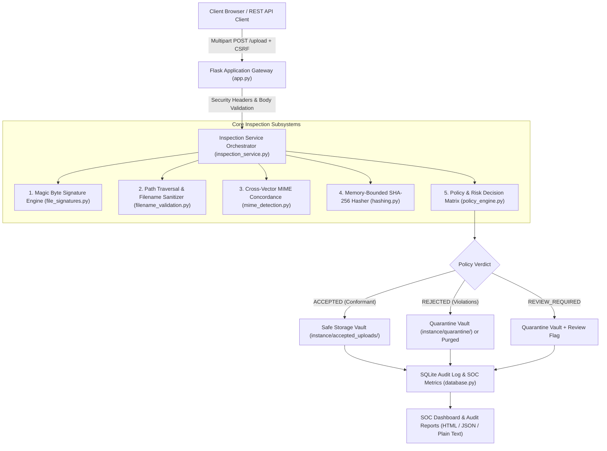
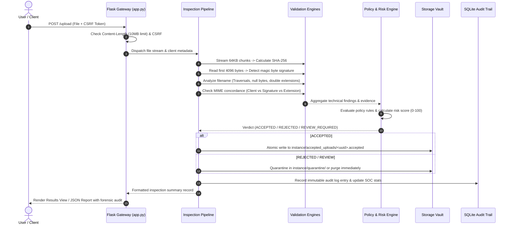
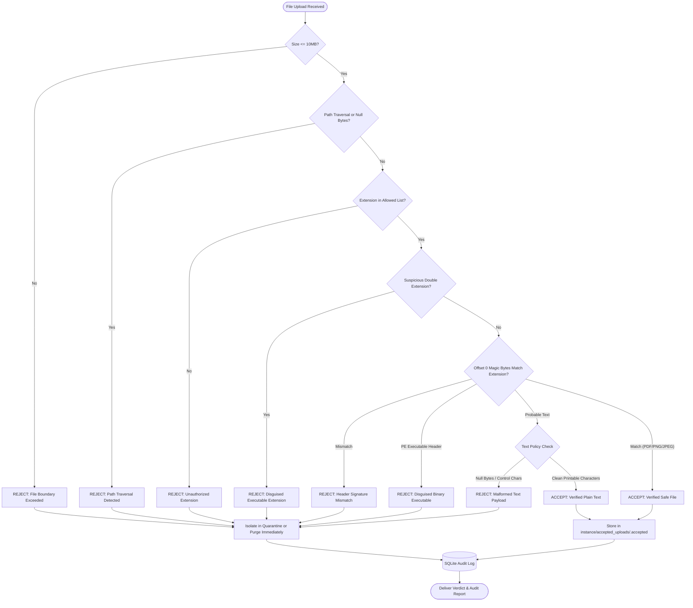

# SecureUpload Inspector — Multi-Vector File Upload Security Engine

> **An Academic Cybersecurity Project for Defense-in-Depth File Ingestion Controls**  
> *Low-level magic-byte verification, path traversal mitigation, cryptographic stream hashing, and segregated storage isolation.*

[](https://www.python.org/downloads/)
[](https://opensource.org/licenses/MIT)
[](https://docs.pytest.org/)
[](https://owasp.org/)
[](https://cwe.mitre.org/data/definitions/434.html)

---

## 📑 Contents

1. [Abstract & Problem Statement](#1-abstract--problem-statement)
2. [System Architecture](#2-system-architecture)
3. [Security Design & Inspection Vectors](#3-security-design--inspection-vectors)
4. [File Ingestion Lifecycle & Workflow](#4-file-ingestion-lifecycle--workflow)
5. [Storage Isolation & Quarantine Vaults](#5-storage-isolation--quarantine-vaults)
6. [Module Catalog](#6-module-catalog)
7. [Running the Application](#7-running-the-application)
8. [Automated Test Suite](#8-automated-test-suite)
9. [Demonstration Scenarios (A through J)](#9-demonstration-scenarios-a-through-j)
10. [Academic Security Notice](#10-academic-security-notice)

---

## 1. Abstract & Problem Statement

Web applications routinely accept user-supplied files, exposing internal servers to critical security risks including Remote Code Execution (RCE), Server-Side Request Forgery (SSRF), directory traversal, and resource exhaustion (**CWE-434**, **OWASP Top 10 A04/A08**).

Many web applications validate uploaded files using shallow, easily bypassable checks:
1. **Relying solely on filename extensions:** Attackers rename executable binaries (e.g., `malware.exe` to `invoice.pdf` or `webshell.php.png`) to bypass superficial allowlists.
2. **Blindly trusting HTTP `Content-Type` headers:** The `Content-Type` header is set by the client browser or attacker proxy (`curl`, Burp Suite) and can be spoofed arbitrarily.
3. **Improper file storage:** Storing user files inside public web roots (`static/` or `public/`) with user-supplied filenames enables direct URL execution and directory traversal.
4. **False senses of security:** Mistaking format compliance for proof of safety, ignoring embedded payloads (e.g., PDF `/JavaScript` actions or macro vectors).

**SecureUpload Inspector** provides a defense-in-depth security verification engine that validates untrusted file uploads across multiple inspection vectors: low-level magic byte signature verification, cryptographic SHA-256 fingerprinting, path traversal defense, double extension detection, and cross-vector MIME concordance checks.

---

## 2. System Architecture



---

## 3. Security Design & Inspection Vectors

### The 5 Inspection Vectors

1. **Magic Byte Signature Verification (`inspector/file_signatures.py`):**
   - Directly checks offset 0 magic bytes:
     - `%PDF-` (`0x25 0x50 0x44 0x46 0x2D`) for PDF documents.
     - `\x89PNG\r\n\x1a\n` (`0x89 0x50 0x4E 0x47 0x0D 0x0A 0x1A 0x0A`) for PNG images.
     - `\xFF\xD8\xFF` for JPEG images.
     - `MZ` (`0x4D 0x5A`) to detect Windows PE executables disguised under benign extensions.
   - Text heuristics: Evaluates UTF-8 decodability, printable character ratios (>= 90%), and absence of null bytes.
2. **Filename & Path Traversal Sanitization (`inspector/filename_validation.py`):**
   - Blocks directory traversal sequences (`..`, `../`, `..\`).
   - Blocks absolute paths (`/etc/passwd`, `C:\Windows\System32`).
   - Intercepts null-byte injection (`\x00`).
   - Intercepts executable double extensions (e.g., `invoice.pdf.exe`).
3. **Cross-Vector MIME Concordance (`inspector/mime_detection.py`):**
   - Correlates client-declared MIME, file extension, and detected byte signatures. Any mismatch triggers an immediate policy violation.
4. **Memory-Bounded Cryptographic Hashing (`inspector/hashing.py`):**
   - Streams files in **64 KB chunks** to calculate SHA-256 digests without unbounded memory usage.
   - Uses constant-time comparisons (`hmac.compare_digest`) to prevent timing side-channels.
5. **Deterministic Policy Engine (`inspector/policy_engine.py` & `risk_assessment.py`):**
   - Evaluates modular rules and calculates a bounded heuristic risk score (0–100).
   - Generates definitive verdicts: `ACCEPTED`, `REJECTED`, or `REVIEW_REQUIRED`.

---

## 4. File Ingestion Lifecycle & Workflow

### Lifecycle Sequence



### Inspection Decision Logic



---

## 5. Storage Isolation & Quarantine Vaults

- **Vaults Outside Web Root:** Storage is managed in `instance/accepted_uploads/` and `instance/quarantine/`, completely removed from `static/`.
- **Random UUID Filenames:** Files are stored as `<uuid4>.accepted` or `<uuid4>.quarantine`. The user's original filename is preserved only in the SQLite audit log.
- **Atomic Operations:** Temporary staging files are atomically renamed upon validation completion to prevent incomplete or corrupt file ingestion.
- **Strict Permission Masking:** Non-executable file permissions (`0o600`) ensure stored files cannot be executed by server worker processes.
- **Rejection Guarantee:** Rejected files **never** enter the accepted storage vault.

---

## 6. Module Catalog

| Module | Location | Purpose & Security Controls |
| :--- | :--- | :--- |
| `app.py` | Package Root | Flask application factory, route definitions, CSRF protection, and CSP headers middleware. |
| `config.py` | Package Root | Security configuration environments (`Development`, `Testing`, `Production`). |
| `file_signatures.py` | `inspector/` | Bounded file signature detector for PDF, PNG, JPEG, PE/MZ, and UTF-8 text heuristics. |
| `filename_validation.py` | `inspector/` | Filename sanitization, path traversal interception (`..`), and double-extension blocking. |
| `mime_detection.py` | `inspector/` | Multi-vector concordance check comparing client MIME, extension, and byte signatures. |
| `hashing.py` | `inspector/` | Incremental streaming SHA-256 digestion using 64 KB memory-bounded buffers. |
| `policy_engine.py` | `inspector/` | Modular rule evaluation delivering `ACCEPTED`, `REJECTED`, or `REVIEW_REQUIRED` verdicts. |
| `risk_assessment.py` | `inspector/` | Heuristic risk assessment score (0–100) based on severity weights. |
| `inspection_service.py` | `services/` | 10-stage inspection orchestrator tying validation, hashing, storage, and database persistence. |
| `quarantine_service.py` | `services/` | Safe storage manager handling atomic writes, UUID filenames, and quarantine isolation. |
| `report_service.py` | `services/` | Plain-text, JSON, and print-friendly audit report generators. |
| `database.py` | `storage/` | Parameterized SQLite database manager handling audit records and SOC metric aggregations. |
| `audit_log.py` | `storage/` | Audit event logger for system actions, policy reconfigurations, and inspection verdicts. |

---

## 7. Running the Application

### Launching the Server
From the repository root or package directory:

```powershell
# Using uv (fastest)
uv venv .venv --python 3.11
uv pip install -r SecureUploadInspector/requirements.txt --python .venv\Scripts\python.exe
.venv\Scripts\python.exe SecureUploadInspector/app.py

# Or using standard python
python SecureUploadInspector/app.py
```

### Localhost Endpoints

- **SOC Dashboard:** [http://localhost:5050/](http://localhost:5050/)
- **File Upload Portal:** [http://localhost:5050/upload](http://localhost:5050/upload)
- **Audit Log Explorer:** [http://localhost:5050/history](http://localhost:5050/history)
- **Policy Settings:** [http://localhost:5050/settings](http://localhost:5050/settings)
- **Architecture Guide:** [http://localhost:5050/about](http://localhost:5050/about)

---

## 8. Automated Test Suite

Run all 86 unit, integration, and scenario tests:

```powershell
.venv\Scripts\pytest -v
```

---

## 9. Demonstration Scenarios (A through J)

| Scenario | Sample File | Threat Simulated | Expected Verdict | Applied Rule |
| :--- | :--- | :--- | :--- | :--- |
| **TEST A** | `document.pdf` | Valid benign PDF document (`%PDF-1.4`) | **`ACCEPTED`** | All checks pass |
| **TEST B** | `spoof.pdf` | PNG image renamed with `.pdf` extension | **`REJECTED`** | `POL-AGREE-001` (Extension vs. signature conflict) |
| **TEST C** | `setup.exe` | Executable binary | **`REJECTED`** | `POL-EXT-001` (Unauthorized extension) |
| **TEST D** | `huge.pdf` | File exceeding configured size limit | **`REJECTED` (413)** | `POL-SIZE-002` (File size boundary exceeded) |
| **TEST E** | `audit.txt` | Content tamper verification | **Hashes differ** | SHA-256 cryptographic sensitivity verification |
| **TEST F** | `blob.txt` | Arbitrary binary with embedded null bytes | **`REJECTED` / `REVIEW`** | Text heuristic failure (Never certified safe) |
| **TEST G** | `report.pdf` | Genuine PDF exported to JSON & Text | **Concordant data** | Report values match stored SQLite fields |
| **TEST H** | `trojan.pdf` | Disguised PE binary (`MZ` magic bytes) | **Quarantined** | File never enters accepted storage vault |
| **TEST I** | `../../passwd.pdf`| Directory traversal sequence | **`REJECTED`** | `POL-NAME-001` (Path traversal sequence intercepted) |
| **TEST J** | N/A | Fresh empty database initialization | **200 OK (Clean)** | Safe zero-state without crashing |

---

## 10. Academic Security Notice

> [!IMPORTANT]
> **Mandatory Academic Security Assertion:**  
> Passing file validation confirms structural compliance with format specifications, signature consistency, and organizational upload policies. **It does not claim or guarantee that a validated file is free of malware.** Sophisticated exploits (such as PDF JavaScript payloads, font engine exploits, or steganographic polyglots) can reside inside structurally valid files. Complete operational defense requires supplementary sandboxed dynamic analysis and runtime privilege separation.
